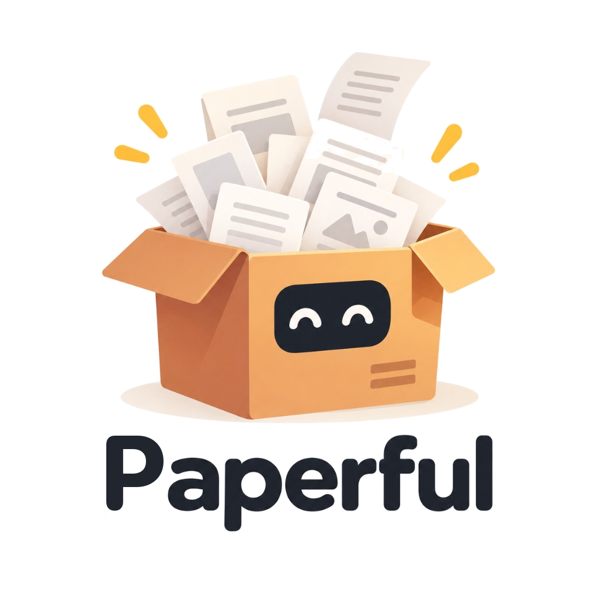
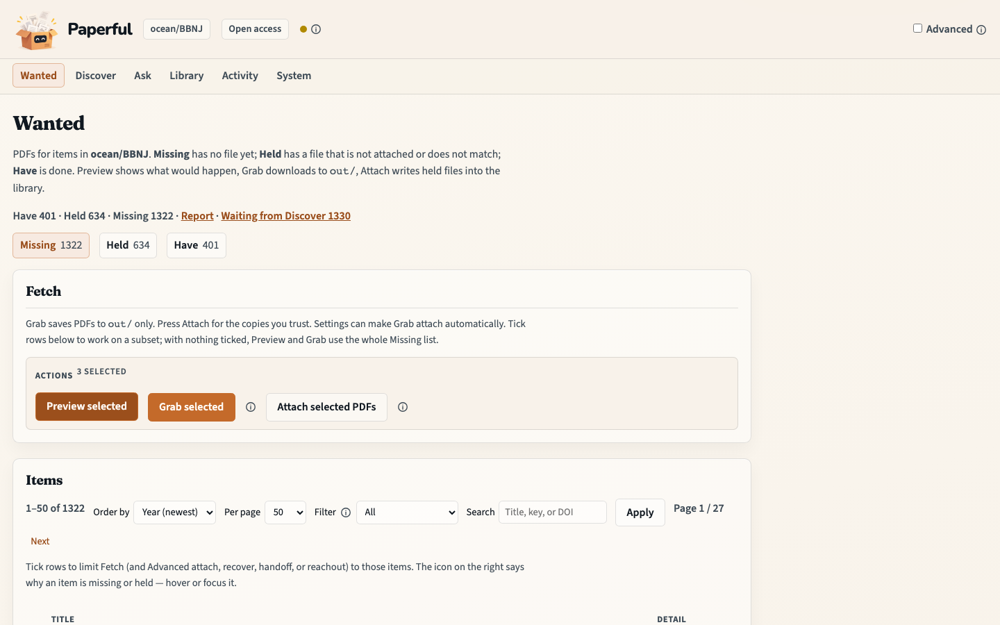
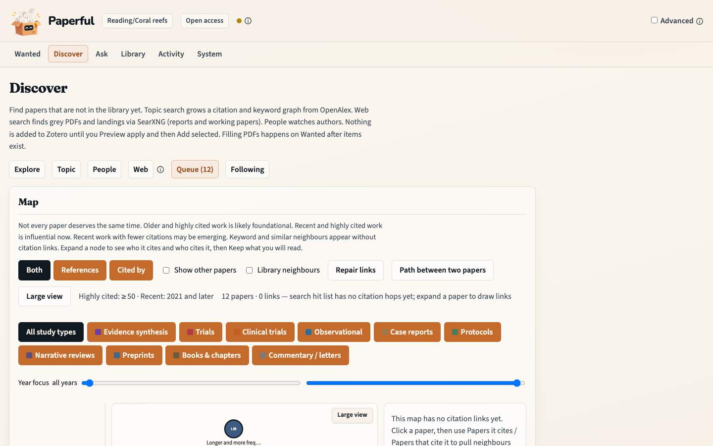
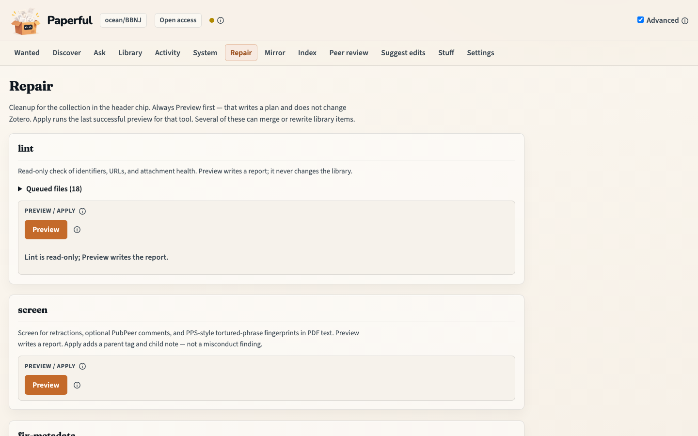
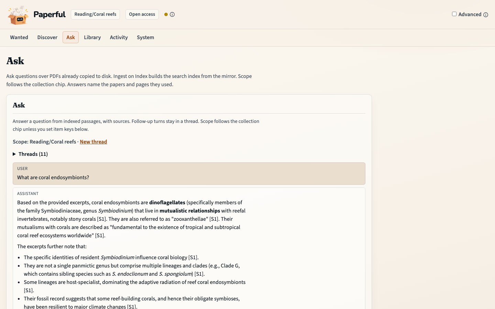
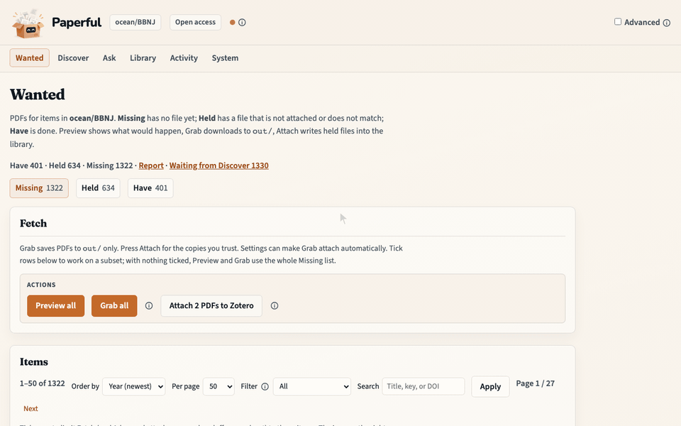

<h1 align="center">
  <picture>
    <source media="(prefers-color-scheme: dark)" srcset="https://raw.githubusercontent.com/glen-w/Paperful/main/website/images/logo-dark.png" />
    
  </picture>
</h1>

<p align="center">
  <a href="https://github.com/glen-w/Paperful/actions/workflows/ci.yml"></a>
  <a href="https://github.com/glen-w/Paperful/actions/workflows/ci.yml"></a>
  <a href="https://paperful.app/guide/"></a>
  <a href="https://pypi.org/project/paperful/"></a>
  
  <a href="LICENSE"></a>
</p>

<p align="center">
  <strong>Find missing PDFs. Clean up your library. Keep control of your papers.</strong>
</p>

Paperful is a **local workbench** for a Zotero library you already keep.

It finds PDFs that are missing, tidies the records, and keeps a folder of
copies on this computer. It looks for free copies first, then uses your
campus login when you have one. Downloads always go into that folder first.
On Zotero 10 or newer you can attach them yourself, or let a download attach
them. On Zotero 7–9 the files stay in the folder; you attach them in Zotero.

Zotero is well tested. Mendeley and EndNote are seeking testers.
[How it compares](docs/comparison.md). Fetch stance and what never leaves
this machine: [legal and privacy](docs/legal-privacy.md).

## What it does

Every fetch lands in a folder on this computer first: open-access copies when
they exist, campus login when you have it, then you attach the files you
trust. Zotero stays the catalogue. Optional notes and answers use a model
only when you turn one on, and they point back at the PDFs you already hold.

The default nav is Wanted, Discover, Ask, Library, Activity, and System.
Ask answers need optional AI turned on. ⚙️ marks Advanced; 🤖 marks optional
AI (off until you enable it — local [Ollama](https://ollama.com) when the
machine can run it, or hosted APIs via
[LiteLLM](docs/llm.md#litellm-paid--openai-compatible-apis)).

### Fill missing PDFs

| Tool | What it does | Guide |
| --- | --- | --- |
| [Wanted](docs/first-fill.md) | See which items still need a PDF, Preview what a search would find, Grab copies into `out/`, Attach the ones you trust (Zotero 10 or newer; on 7–9 the files stay in the folder) | [guide](docs/first-fill.md) |
| [Library](docs/gui.md) | Collection tree with item and missing-PDF counts; the target icon sets the scope for the rest of the workbench | [guide](docs/gui.md) |
| [Sources](docs/how-it-works.md) | Free copies first (Unpaywall, OpenAlex, and the rest of the open-access lane), campus EZProxy when you choose Campus, playbooks for odd landings | [guide](docs/sources.md) |
| [Firefox add-on](docs/firefox.md) | Save the page you are reading, or several tabs, into the folder copy. The Zotero Connector stays the way to save into Zotero. This one does not attach | [guide](docs/firefox.md) |
| Recover ⚙️🤖 | Optional browser agent for landings the scripted sources missed (`paperful[browser-agent]`, Python 3.11+) | [guide](docs/browser-agent-models.md) |

### Grow the library

| Tool | What it does | Guide |
| --- | --- | --- |
| [Discover](docs/grow-library.md) | Topic search, citation map, Keep/Skip queue, then metadata parents — PDFs still go through Wanted | [guide](docs/snowball.md) |
| [People](docs/authorwatch.md) | Follow ORCID / OpenAlex authors; run the list; accept new works into the collection | [guide](docs/authorwatch.md) |
| [Web](docs/grey-search.md) | Grey-literature hits via SearXNG; Preview apply creates parents | [guide](docs/grey-search.md) |
| [Research pack](docs/research-pack.md) | Works cited in a PDF you already hold → parents in the collection → fill PDFs | [guide](docs/research-pack.md) |
| [Keepup](docs/keepup.md) | Poll topic watches, people lists, and what-cites on a cadence you cron; no email | [guide](docs/keepup.md) |

### Tidy the library

| Tool | What it does | Guide |
| --- | --- | --- |
| [Repair](docs/tidy-library.md) ⚙️ | Check identifiers, fix metadata, review duplicates, repair attachments, OCR scans, flag retractions / PubPeer / tortured phrases | [guide](docs/tidy-library.md) |
| [Mirror](docs/quiet-mirror.md) ⚙️ | Folder copy of the collection (`out/` + `state/`); snapshot, restore, sync. You copy the folder when you want a backup or a handoff | [guide](docs/quiet-mirror.md) |
| [Import / export](docs/commands.md) | RIS, BibTeX, and EndNote XML | [guide](docs/commands.md) |

### Read papers you already have

| Tool | What it does | Guide |
| --- | --- | --- |
| [Ask](docs/rag.md) 🤖 | Questions over PDFs already on disk, answered with a link to the passage; simple or advanced | [guide](docs/rag.md) |
| [Briefs](docs/ai.md) ⚙️🤖 | Per-item summary and a collection review from the mirror. CLI `summarize --receipts` drops sentences that cannot quote the PDF | [guide](docs/llm.md) |
| [Index](docs/rag.md) ⚙️ | Ingest the mirror, search passages, extract questions, see what is already answered, pull IMRaD-style sections | [guide](docs/rag.md) |
| [Claim check](docs/rag.md#claim-check) | Per-sentence support vs the index (CLI `ask --claim-check`; no chat model) | [guide](docs/rag.md#claim-check) |
| [Evidence](docs/evidence.md) | Sourced n / method / finding table over PDFs you hold; each cell is a quote or `check this`. No chat model. CLI only | [guide](docs/evidence.md) |

### Check a draft

| Tool | What it does | Guide |
| --- | --- | --- |
| [Peer review](docs/peer-review.md) ⚙️ | A draft you already wrote: structure and citations always; optional claim locators against held PDFs; optional comparison with this library. Not a grade | [guide](docs/peer-review.md) |
| [Suggest edits](docs/rewrite.md) ⚙️ | Apply a peer-review pack as locatable edits / tracked changes; never overwrites the source | [guide](docs/rewrite.md) |
| [Stuff](docs/stuff.md) ⚙️ | Extra library cites per sentence or outline section (needs the index; no chat model) | [guide](docs/stuff.md) |

New here: [first 10 minutes](docs/first-10-minutes.md).
Walkthroughs: [first fill](docs/first-fill.md), [grow the library](docs/grow-library.md),
[tidy a collection](docs/tidy-library.md). All of them: [Walkthroughs](docs/walkthroughs.md).

## Screenshots









## From a collection to PDFs on your computer

1. Start the workbench and open http://127.0.0.1:8765 (the **Wanted** page).
2. Choose a collection on **Library**.
3. **Preview** what can be found, then **Grab** the files. They are saved in a folder on this computer (`out/`). By default you open that folder and **Attach** the copies you want. In Settings you can have Grab attach them for you on Zotero 10 or newer. On Zotero 7–9 the files stay in the folder; attach them in Zotero.



Full walkthrough: [First fill](docs/first-fill.md). How a search works:
[How it works](docs/how-it-works.md). The same actions from the command line:
[Commands](docs/commands.md).

## Quick start

Clone the repo and build the image with Compose.

**You need**

- [Docker](https://docs.docker.com/get-docker/) with Compose v2.
- Zotero **open on the host** (not in Docker), local API enabled:
  Settings → Advanced → *Allow other applications on this computer to communicate with Zotero*.
  Open Zotero before you run doctor.
- Zotero 10 or newer to attach PDFs (manual **Attach**, or automatic on Grab).
  On Zotero 7–9 the tool still downloads to disk; attach later in Zotero.
  [Zotero](docs/zotero.md).
- A one-time browser sign-in on this computer if you use a campus library
  login. The workbench itself runs from Docker. [Docker](docs/docker.md).
- A real email address in the config file. The free-copy lookup (Unpaywall)
  will not run without it.

No campus access: choose **Open access**. Campus library login: choose
**Campus** after you set your library proxy address.
[Configuration](docs/config.md).

```sh
git clone --branch v1.9.9 https://github.com/glen-w/Paperful.git
cd Paperful
cp .env.example .env
mkdir -p ../paperful-data ../paperful-out
cp config.minimal.toml ../paperful-data/config.toml   # set email
docker compose build
docker compose run --rm paperful doctor
docker compose up
```

Compose reads `config.toml` from `PAPERFUL_DATA` and the PDF mirror from
`PAPERFUL_OUT` (the `.env` defaults are `../paperful-data` and
`../paperful-out`), not from the git root. To keep data in the checkout, set
`PAPERFUL_DATA=.` and `PAPERFUL_OUT=./out` in `.env`, then copy `config.toml`
next to `compose.yaml`. Where those files live, and what the first health
check means if Zotero is not open yet: [Docker](docs/docker.md).

The guide and this README track `main`. `pip` and the `v1.9.9` tag are the
current release.

The same jobs from the command line: [Commands](docs/commands.md).

Campus library login: [EZProxy](docs/ezproxy.md).
Optional libraries (seeking testers): [Mendeley](docs/mendeley.md),
[EndNote](docs/endnote.md).

Site: [paperful.app](https://paperful.app/).

Reference:

- [Walkthroughs](docs/walkthroughs.md) — Wanted, Discover, Repair
- [Example setups](docs/example-setups.md) — one collection, campus, a growing desk, all-in
- [Docker](docs/docker.md) — operator install; light/heavy packs
- [Workbench](docs/gui.md) — pages, Preview tokens, what stays CLI
- [Commands](docs/commands.md) · [Workflows](docs/workflows.md) · [Configuration](docs/config.md)
- [Source routing](docs/sources.md) · [Camofox](docs/camofox.md) · [Quiet mirror](docs/quiet-mirror.md)
- [Why Paperful](docs/why.md) · [Roadmap](docs/ROADMAP.md)

## On your machine

Paperful runs on this computer. It does not upload your library to a
Paperful server. Downloads, notes, and the folder of copies stay here.
Zotero stays your catalogue. Notes and questions use a model only when you
enable one — usually **Ollama** on your computer, or an external provider
through **LiteLLM** if you prefer hosted APIs. [Terms](docs/TERMS.md).

Read the file before you trust a note or an answer:

1. See which items are still missing a PDF.
2. Paperful downloads the PDF and saves it in a folder on your computer.
3. You open that folder and read the file.
4. Then you write a note or ask a question.

**Attach** is the step that puts the PDF into Zotero. How a search is checked
before it runs, and how each file records where it came from:
[How it works](docs/how-it-works.md).

## Optional: ask your papers

Asking questions of PDFs you already have is off until you turn it on.
**Local first:** run models on this computer with Ollama when your hardware
can support the tags you need (summaries from ~7B; the browser agent from
~14B). **Optional hosted APIs:** install `paperful[llm]` and set
`provider = "litellm"` to call OpenAI, Anthropic, or another LiteLLM-backed
service (API keys in the environment, not in `config.toml`). Commands print
a notice when text leaves the machine. **Ask** is in the workbench; notes, collection reviews, and **Peer review**
are under Advanced.

[What is feasible (local vs hosted, library scale)](docs/ai.md) ·
[LLM setup](docs/llm.md) · [Ask your library](docs/rag.md).

```sh
ollama pull qwen2.5:7b                       # local default; then enable [llm] in config
# Ask also needs: ollama pull nomic-embed-text
# Hosted instead: uv sync --extra llm  — see docs/llm.md
```

## Install with pip

Workbench on the host (Zotero open, local API on; no Docker image). The
`uv tool` line was run on a Linux box; `pipx` is the same shape and was not
run in that check. Chromium downloads on first campus login.

You need Zotero open and an email address (Unpaywall).

```sh
uv tool install "paperful[serve]"     # or: pipx install "paperful[serve]"
mkdir my-paperful && cd my-paperful
printf 'email = "you@university.edu"\n' > config.toml
paperful doctor
paperful serve                        # http://127.0.0.1:8765
```

Campus login / HTML PDF: install `"paperful[serve,browser]"` instead.

Optional extras: `[browser]`, `[llm]`, `[rag]`, `[rag-docling]`,
`[rag-liteparse]`, `[browser-agent]` (Python 3.11+), `[openxml]`,
`[network]`. The operator path is **clone + Compose**
([Docker](docs/docker.md)). GitHub CI currently runs the smoke tests only
(Ubuntu, Python 3.12); the full suite runs locally. It does not build the
image or install a fresh `paperful[serve]` venv.

## Develop

Contributors use [uv](https://docs.astral.sh/uv/) (Python 3.10+). Operators
use the Compose steps above.

```sh
uv sync --group dev
cp config.example.toml config.toml
uv run paperful doctor
uv run pytest
```

Local docs preview: `uv sync --extra docs && make pages-site`.
Workbench screenshots: `uv run python scripts/docs/capture_workbench.py`;
workflow GIFs: `uv run python scripts/docs/record_workflows.py` (needs
`ffmpeg`). Both run against a live workbench (`docker compose up`, or
`PAPERFUL_UI=http://127.0.0.1:<port>` for `paperful serve --port`).
See [CONTRIBUTING](CONTRIBUTING.md).

## License

[MIT](LICENSE)

---

<p align="center">
  <a href="https://ko-fi.com/C0C1XK8G" target="_blank" rel="noopener noreferrer"></a>
</p>
