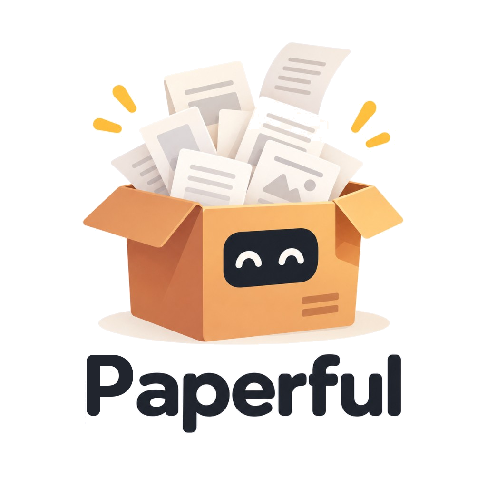
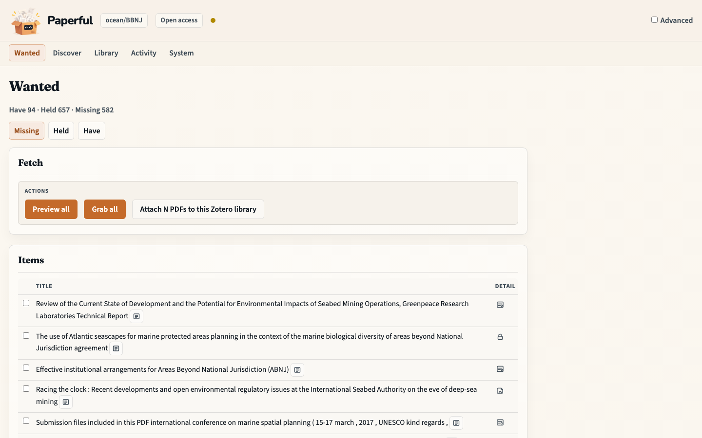
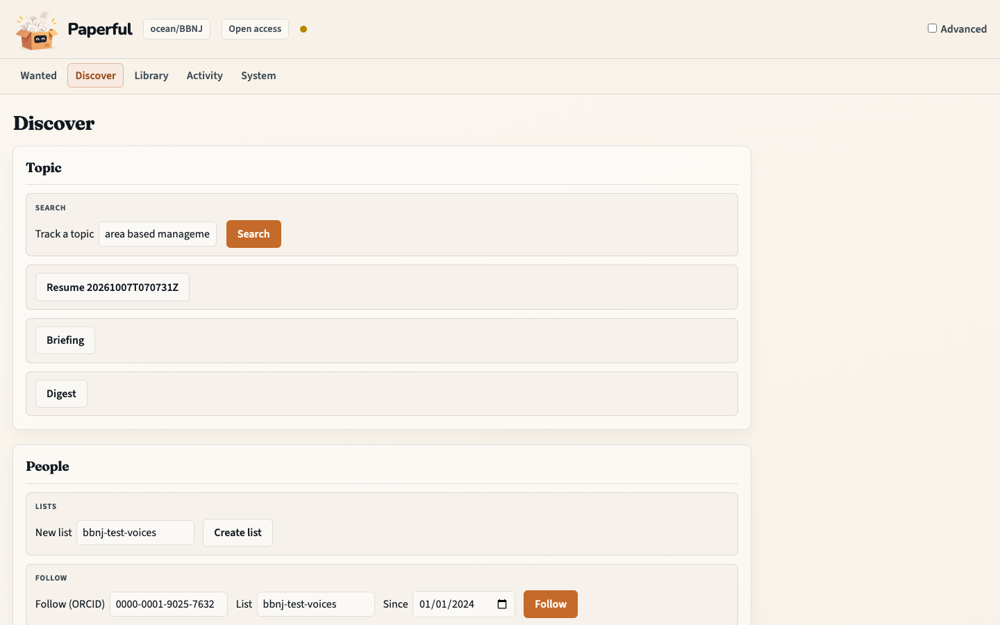
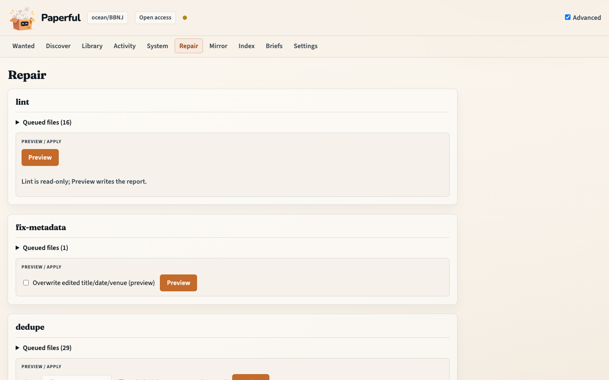
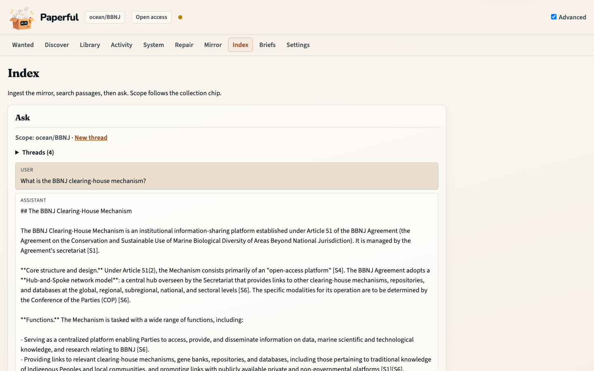

<h1 align="center">
  <picture>
    <source media="(prefers-color-scheme: dark)" srcset="website/images/logo-dark.png" />
    
  </picture>
</h1>

<p align="center">
  <a href="https://github.com/glen-w/Paperful/actions/workflows/ci.yml"></a>
  <a href="https://github.com/glen-w/Paperful/actions/workflows/ci.yml"></a>
  <a href="https://paperful.app/guide/"></a>
  <a href="https://pypi.org/project/paperful/"></a>
  
  <a href="LICENSE"></a>
</p>

<p align="center">
  <strong>Find missing PDFs. Clean up your library. Keep control of your papers.</strong>
</p>

Paperful is a **local workbench** for a Zotero library you already keep.

It finds PDFs that are missing, tidies the records, and keeps a folder of
copies on this computer. It looks for free copies first, then uses your
campus login when you have one. Downloads always go into that folder first.
On Zotero 10 or newer you can attach them yourself, or let a download attach
them. On Zotero 7–9 the files stay in the folder; you attach them in Zotero.

Zotero is well tested. Mendeley and EndNote are seeking testers.
[How it compares](docs/comparison.md).

## What can I do with it?

- See which items still need a PDF, check what a search would find, then download the files onto this computer
- Add papers from a topic search or from people you follow (the record first; the PDF after)
- Check identifiers, review duplicates, and repair broken attachments
- Keep a folder of your papers that you can back up or give to another tool
- Optionally ask questions of the PDFs you already have (local models via [Ollama](https://ollama.com) when your machine can run them, or hosted APIs via [LiteLLM](docs/llm.md#litellm-paid--openai-compatible-apis) — off until you turn it on)

Walkthroughs: [first fill](docs/first-fill.md), [grow the library](docs/grow-library.md),
[tidy a collection](docs/tidy-library.md). All of them: [Walkthroughs](docs/walkthroughs.md).

## Screenshots









## From a collection to PDFs on your computer

1. Start the workbench and open http://127.0.0.1:8765 (the **Wanted** page).
2. Choose a collection on **Library**.
3. **Preview** what can be found, then **Grab** the files. They are saved in a folder on this computer (`out/`). By default you open that folder and **Attach** the copies you want. In Settings you can have Grab attach them for you on Zotero 10 or newer. On Zotero 7–9 the files stay in the folder; attach them in Zotero.

Full walkthrough: [First fill](docs/first-fill.md). How a search works:
[How it works](docs/how-it-works.md). The same actions from the command line:
[Commands](docs/commands.md).

## Quick start

Clone the repo and build the image with Compose.

**You need**

- [Docker](https://docs.docker.com/get-docker/) with Compose v2.
- Zotero **on the host** (not in Docker), local API enabled:
  Settings → Advanced → *Allow other applications on this computer to communicate with Zotero*.
- Zotero 10 or newer to attach PDFs (manual **Attach**, or automatic on Grab).
  On Zotero 7–9 the tool still downloads to disk; attach later in Zotero.
  [Zotero](docs/zotero.md).
- A one-time browser sign-in on this computer if you use a campus library
  login. The workbench itself runs from Docker. [Docker](docs/docker.md).
- A real email address in the config file. The free-copy lookup (Unpaywall)
  will not run without it.

No campus access: choose **Open access**. Campus library login: choose
**Campus** after you set your library proxy address.
[Configuration](docs/config.md).

```sh
git clone --branch v1.0 https://github.com/glen-w/Paperful.git
cd Paperful
cp .env.example .env          # PAPERFUL_DATA=. PAPERFUL_OUT=./out keeps data here
                              # .env.example sets PAPERFUL_IMAGE_MODE=heavy
cp config.minimal.toml config.toml   # set email; full file is config.example.toml
docker compose build                 # heavy when set in .env; CI uses light
docker compose run --rm paperful doctor          # once; --guide for Enter walk
docker compose up                                # stays up; workbench at http://127.0.0.1:8765
```

The sample `.env` keeps your config and downloads in this folder. Where those
files live, and what the first health check means if Zotero is not open yet:
[Docker](docs/docker.md).

The same jobs from the command line: [Commands](docs/commands.md).

Campus library login: [EZProxy](docs/ezproxy.md).
Optional libraries (seeking testers): [Mendeley](docs/mendeley.md),
[EndNote](docs/endnote.md).

Site: [paperful.app](https://paperful.app/).

Reference:

- [Walkthroughs](docs/walkthroughs.md) — Wanted, Discover, Repair
- [Example setups](docs/example-setups.md) — one collection, campus, a growing desk, all-in
- [Docker](docs/docker.md) — operator install; light/heavy packs
- [Workbench](docs/gui.md) — pages, Preview tokens, what stays CLI
- [Commands](docs/commands.md) · [Workflows](docs/workflows.md) · [Configuration](docs/config.md)
- [Source routing](docs/sources.md) · [Camofox](docs/camofox.md) · [Quiet mirror](docs/quiet-mirror.md)
- [Why Paperful](docs/why.md) · [Roadmap](docs/ROADMAP.md)

## On your machine

Paperful runs on this computer. It does not upload your library to a
Paperful server. Downloads, notes, and the folder of copies stay here.
Zotero stays your catalogue. Notes and questions use a model only when you
enable one — usually **Ollama** on your computer, or an external provider
through **LiteLLM** if you prefer hosted APIs. [Terms](docs/TERMS.md).

Read the file before you trust a note or an answer:

1. See which items are still missing a PDF.
2. Paperful downloads the PDF and saves it in a folder on your computer.
3. You open that folder and read the file.
4. Then you write a note or ask a question.

**Attach** is the step that puts the PDF into Zotero. How a search is checked
before it runs, and how each file records where it came from:
[How it works](docs/how-it-works.md).

## Optional: ask your papers

Asking questions of PDFs you already have is off until you turn it on.
**Local first:** run models on this computer with Ollama when your hardware
can support the tags you need (summaries from ~7B; the browser agent from
~14B). **Optional hosted APIs:** install `paperful[llm]` and set
`provider = "litellm"` to call OpenAI, Anthropic, or another LiteLLM-backed
service (API keys in the environment, not in `config.toml`). Commands print
a notice when text leaves the machine. **Ask** is in the workbench; notes and
collection reviews are under Advanced.

[What is feasible (local vs hosted, library scale)](docs/ai.md) ·
[LLM setup](docs/llm.md) · [Ask your library](docs/rag.md).

```sh
ollama pull qwen2.5:7b                       # local default; then enable [llm] in config
# Ask also needs: ollama pull nomic-embed-text
# Hosted instead: uv sync --extra llm  — see docs/llm.md
```

## Install with pip

For a **CLI on the host** (Zotero local API on this machine; no Docker
workbench image):

```sh
pip install paperful
playwright install chromium    # once; needed for campus login / HTML PDF
cp config.minimal.toml config.toml   # set email — see docs/config.md
paperful doctor
```

Optional extras: `[llm]`, `[rag]`, `[serve]` (workbench), `[browser-agent]`.
The operator path tested in CI is still **clone + Compose** ([Docker](docs/docker.md)).

## Develop

Contributors use [uv](https://docs.astral.sh/uv/) (Python 3.10+). Operators
use the Compose steps above.

```sh
uv sync --group dev
cp config.example.toml config.toml
uv run paperful doctor
uv run pytest
```

Local docs preview: `uv sync --extra docs && make pages-site`.
Workbench screenshots: `.venv/bin/python scripts/docs/capture_workbench.py`
against a running `docker compose up`. See [CONTRIBUTING](CONTRIBUTING.md).

## License

[MIT](LICENSE)

---

<p align="center">
  <a href="https://ko-fi.com/C0C1XK8G" target="_blank" rel="noopener noreferrer"></a>
</p>
