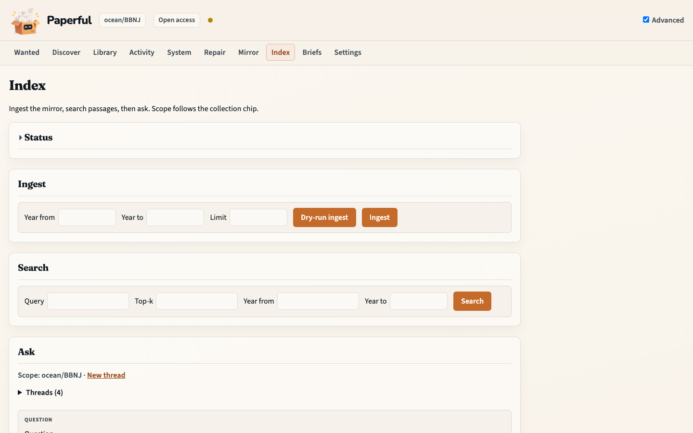

# Paperful workbench

A **local GUI** over the same verbs as the CLI. `docker compose up` (or
`paperful serve`) binds http://127.0.0.1:8765. Zotero remains the catalogue
and reader. Grab fetches to `out/`. Attach writes the library — you press
it (manual, the default) or Grab does it (automatic, Settings) when the
library can be written.

**Status:** shipped. **Ask** is on the default nav (`/ask`;
opt-in `[rag]` + `[llm]`). An optional unsigned
[Firefox add-on](firefox.md) saves the page you are reading into `out/`.
The Zotero Connector stays the way to save into Zotero. Hosted SaaS stays
later — see [ROADMAP — Product split](ROADMAP.md#product-split-10-vs-post-10).

Jobs, with screenshots: [Walkthroughs](walkthroughs.md)
([first fill](first-fill.md), [grow](grow-library.md),
[tidy](tidy-library.md)).


---

## Product framing

Three jobs sit on the default nav:

| Nav | CLI verbs | Job |
| --- | --- | --- |
| **Wanted** | `gaps`, `run`, `attach` | See missing PDFs, preview fetch, grab to `out/`, attach chosen copies |
| **Discover** | `snowball`, `authorwatch`, watches | Find new works (topic or person), review, add metadata parents |
| **Ask** | `ask`, `ask --from-file` | Cited answers from PDFs already copied to disk (needs `[rag]` + `[llm]` and an index) |

**Library**, **Activity**, and **System** support the loop. **Repair**, **Mirror**,
**Index** (ingest / search / extract), **Briefs**, and **Settings** appear only
when **Advanced** is on (reveal only; does not enable Scholar, Sci-Hub, or LLM).

```text
  Browser  ──HTTP──►  paperful serve  ──►  paperful.* (same as CLI)
                              │
                              ├── LibraryBackend (Zotero / …)
                              └── Ledger: out/ + state/
  CLI / MCP  ─────────────────┘
```

Control rules match the CLI: dry-run before bulk fetch, **Preview → Grab** with a
**review token** (refuse if the library changed), opt-in Scholar / Sci-Hub / LLM /
browser-agent. No built-in scheduler — **Check again** on Discover, not cron.

---

## Shell chrome

| Control | Role |
| --- | --- |
| **Logo** | Product lockup (box + Nunito wordmark) links to Wanted; fonts match the public site (Fraunces / Nunito / Source Sans 3) |
| **Collection** chip | Scoped collection (remembered in a cookie) |
| **Preset** chip | Open access (`oa`) or Campus (`eoi`) — the simple source choice |
| **Health** dot | Worst cached `doctor` status (amber until **System** runs doctor; pages never block on a full doctor) |
| **Advanced** toggle | Cookie only; reveals extra nav and form fields |
| **Row actions** | Icon buttons (detail drawer, set collection scope) with the action name as the tooltip |
| **Long lists** | Discover uses tabs (Explore / Topic / Grow / People / Queue / Following); Queue paginates. Ask threads and batches, Briefs archives, and the Repair queue fold into collapsible sections |

Layout: table-first rows, native `<dialog>` drawer (no embedded PDF viewer).
Long jobs return a **command id**; Activity subscribes to `GET /v1/runs/{id}/events` (SSE), with JSON poll fallback via `GET /v1/runs/{id}`.
Bind `127.0.0.1`. `docker compose up` publishes `127.0.0.1:8765:8765` only.
Non-loopback bind (`--host 0.0.0.0`) requires `--allow-remote-bind` and still has
**no HTTP auth** — see [SECURITY.md](../SECURITY.md).
`compose.gui.yaml` is a no-op shim for older `-f compose.gui.yaml --profile gui` invocations.

---

## Simple loop

1. **Wanted** — first nav item, and `GET /` lands here. With no collection, or
   when the library is down, an amber coach line points at **System**.
   **Missing** rows use miss-surface icons (hover for `MISS_SURFACE_PLAIN`).
   **Held** / **Have** use the same icon+tooltip pattern for PDF verification
   (`doi_match`, `doi_mismatch`, `unverified`, `snapshot`; not “% complete”).
   A **Found** stamp appears only on `doi_match` (the PDF's DOI equals the
   library item's); every other file on disk gets a **Check** stamp. Each
   **Missing** row prints its one-line reason under the title (the same
   `MISS_SURFACE_PLAIN` text as the tooltip). **Report** (`GET /wanted/report`,
   `format=md|json|csv`) uses the same stamps, so "N found" equals the number
   of Found stamps; `csv` is the `misses.csv` shape for the cleaning service.
   A library PDF flag with no file on the mirror (`verification` `missing`,
   “No PDF file on disk”) lands on **Missing** with the missing-file icon.
   The default tab is the first non-empty bucket (Missing → Held → Have).
   **Waiting from Discover** (a read-only panel above the tabs) lists kept
   queue rows and watch / keepup / authorwatch inbox rows that are not yet in
   the collection; each row can show a **Why suggested** line from the
   candidate's `why`. Add them from Discover and they appear under Missing.
   **Preview** → **Grab** (fetch to the `out/` folder on this computer;
   selected vs all; Grab passes the same `item_keys` as the preview token).
   **Manual** (default): **Attach** writes attachable pending PDFs into
   Zotero (`doi_match` and hand-ticked rows on **Held** with a pending file).
   The main button skips DOI mismatches and short PDFs (use Advanced Attach
   to override). CLI `paperful run` still attaches mismatches unless you pass
   `--strict-pdf-doi`. The label shows **Attach N PDFs** when N are pending;
   the button is disabled when N is 0 and no rows are ticked. **Attach** needs
   Zotero 10 or newer; on 7–9, attach files in Zotero. **Automatic** (Settings
   → **After Grab**, shown only after at least one successful Attach): Grab
   also attaches when the library supports write. Zotero 7–9 never receives
   the file from Paperful. DOI mismatch and short PDF still wait for Attach.
2. **Discover** — Tabs: **Explore**, **Topic**, **Grow** (Advanced),
   **People**, **Queue** (map + paginated candidates), **Following**.
   **Topic:** keyword search (`snowball search` dry-run queue), then open
   **Queue** for per-row Keep/Skip and **Preview apply** → **Add selected**
   (`snowball apply`, metadata only). Queue rows show **Why suggested** when
   the candidate carries a `why` line. **Map** (on Queue) draws that queue
   before you open a PDF: older + highly cited is foundational, recent +
   highly cited is influential, recent + fewer citations may be emerging.
   OpenAlex study designs (RCT, meta-analysis, …) appear as category badges
   and filter chips on top of those roles. Click a paper to Keep/Skip or
   expand one hop (references, or papers that cite it).
   When a [stopping rule](snowball.md#stopping-rules)
   is on, **Next hop** scores those marks and fetches one more hop
   (`snowball continue`). **Fill PDFs** opens Wanted.
   **Briefing** / **Digest** write `briefing.md` / `digest.md` on the queue
   (shown on Queue; digests are not auto-created). Advanced can tick
   **File collection note** (`--apply` + collection chip) to file a Zotero
   collection note tagged `paperful:frontier-briefing`. **Keep an eye on this**
   saves a topic watch only when a snowball **profile** is chosen. **People:**
   create/delete a list, Follow (ORCID + optional backfill), add/edit/remove,
   resolve, run, **Get suggestions** (method + limit + collection) → checkbox
   **Accept** (+ optional seed date), import CSV/JSON/ORCID or saved social
   HTML, **people briefing** (inbox plus OpenAlex recent works / co-authors for
   pollable members; same markdown as CLI `authorwatch briefing`); inbox uses the same Preview → apply pattern
   (`authorwatch apply`). **Check again** re-runs a saved topic watch or
   person list. Topic watches also offer **Preview apply** / **Apply inbox**
   (`snowball watch apply`). Advanced topic watches offer **Watch briefing** /
   **Watch digest** (same optional collection note). Cron alert loop:
   [`keepup`](keepup.md).
3. **Library** — Nested collection collapsibles with item / missing-PDF counts; target icon sets scope (collection chip). Scoped items paginate (default 50 per page; sizes in `[ui]` — see `config.example.toml`).
4. **Activity** — Command history + trust line from `last-run.json`.
5. **System** — `doctor` rows with one next step each.

---

## Advanced surfaces

Same shell; extra verbs call the same domain entrypoints as the CLI. Discover
adds snowball kinds (hybrid/doi/orcid/collection), crawl knobs (including
stop rule, stop eps, stop k, stop max screened, and
**Twenty writeback** → `cfg.twenty_writeback_listings`), profile save/run,
resume, briefing, frontier digest, **refs gap**, **ingest-dois**
(Preview → Apply token), **authors**, and **packs promote**.
Wanted adds attach (mismatch/short), `recover` (from last run:
`browser_agent_miss`, `missing`, `browser_agent_not_found` — same as
`recover --from-last-run-mode`), handoff, inbox drain, `reachout`,
plus Grab filters (`year` / type / retry / try-all / browser-agent / upgrade).
**Repair** Preview runs dry-run then Apply writes: `lint` (read-only report),
`fix-metadata`, `dedupe`, `versions`, `attachments`, `ocr`.
**Mirror** Preview/Apply: `sync`, `snapshot`, `restore`, `cache clean`.
**Ask**: cited Ask when `[rag]` and `[llm]` are on and the index has rows.
Batch Ask (`state/ask-batch/`) is on the same page when **Advanced** is on.
Focus presets, custom prompts (inline, upload, path, or saved under
`state/prompts/`), item keys, types, years, and top-k; batch adds `--force`
and a questions file upload. If the index is empty, Ask offers a compact
ingest. **Index** (Advanced): `rag ingest` / `search` when
`[rag]` is on; **Extract questions** (`rag questions`) and **Already answered?**
(`rag answered`, `state/rq-answered/`) use the same scope. Collection chip is
the scope. **Synthesize** on Index when `[llm]` is on. Structured IMRaD fields
(`extract-sections` → `state/sections/`) are **CLI-only** today — mirror PDFs,
no `[rag].enabled` required; see [rag.md](rag.md#structured-sections-mirror-only).




**Briefs**: collection **summarize** / **synthesize** when `[llm]` is on.
Per-item **summarize** in Wanted/Library drawers (Advanced). **Settings** writes
`config.toml`; it does not enable `[rag]` or `[llm]`.

**Stays CLI** (no GUI control): `session login`, `doctor --guide`, mid-run
EZProxy re-login, snowball `approve-each`, `collections add`, Sci-Hub source
toggles; Ask TTY multi-turn, `--show-context`, and named run profiles.
`paperful all` / named run configs stay [workflows](workflows.md).

---

## HTTP capability API (P0 + GUI)

JSON capability routes live on `paperful serve` (`serve.py`). HTML + form POSTs
are mounted by `paperful.ui` (`mount_ui`).

| Method | Path | Behaviour |
| --- | --- | --- |
| GET | `/health` | `{ok, version}` |
| GET | `/v1/doctor` | Same as `doctor --json` |
| GET | `/v1/collections` | Collection tree |
| GET | `/v1/runs/last` | `state/last-run.json` |
| GET | `/v1/runs/{id}` | GUI command record under `state/gui/commands/` |
| GET | `/v1/runs/{id}/events` | SSE `status` events until `done` or `failed` |
| POST | `/v1/refs-gap` | Dry-run `refs gap` envelope |
| POST | `/v1/ask` | Same as MCP `ask` (not linked from simple HTML) |
| POST | `/v1/gui/noop` | Smoke / readiness for the GUI process |
| GET | `/wanted/report` | Read-only stamp cards for the scoped collection (`format=md|json|csv`; no `% complete`) |
| POST | `/wanted/preview` | Review token for Grab (Advanced: year/type/retry/… flags) |
| POST | `/wanted/grab` | Consume token; fetch to `out/` (`item_keys` from preview). Attaches only when `[ui].attach_mode` is `auto` and the library can write |
| POST | `/wanted/attach/preview` | Review token for held PDF attach |
| POST | `/wanted/attach` | Selected keys or all attachable pending in scope (no mismatch/short on the main button). `review_token`: consume Advanced preview |
| POST | `/wanted/recover/preview` | Review token for browser-agent recover |
| POST | `/wanted/recover` | Consume token; `recover` |
| POST | `/wanted/handoff` | `list` / `tabs` / `walk` / `watch` (never fetches) |
| POST | `/wanted/inbox/drain` | One-shot inbox drain |
| POST | `/wanted/reachout` | Export contact rows; optional RG tabs |
| POST | `/wanted/summarize` | Enqueue single-item `summarize`; redirect `?run=` |
| GET | `/item/{key}/summary` | Per-item HTML under `state/summaries/` |
| POST | `/discover/explore` | Resolve a DOI or title into an explore queue; open Map (picker when title is ambiguous) |
| POST | `/discover/topic` | Enqueue snowball kind (Advanced) or keyword search |
| POST | `/discover/profile-save` | Save snowball profile from the topic form |
| POST | `/discover/refs-gap` | Dry-run refs gap pack for the collection chip |
| POST | `/discover/ingest-preview` | Classify DOIs / refs-gap pack; review token |
| POST | `/discover/ingest-apply` | Consume token; create parents |
| POST | `/discover/authors` | Authors frequency (optional `--apply` pack seed) |
| POST | `/discover/packs-promote` | Promote a proposed field author pack |
| POST | `/discover/follow` | Follow ORCID into a list (`authorwatch` run) |
| POST | `/discover/keep` | Mark queue DOI keep/skip |
| GET | `/discover/graph` | Citation map JSON for `run_id` (`paperful.citation_graph.v1`); optional `watch_name`, `compare_run` |
| GET | `/discover/graph/meta` | Collections/tags plus `[ui].citation_map_*` prefs for the map panel |
| POST | `/discover/graph/expand` | One OpenAlex hop (`refs`, `cites`, or `both`) merged into that queue |
| POST | `/discover/graph/repair` | Re-link rows to hop-0 seeds via OpenAlex (Keep unchanged) |
| POST | `/discover/graph/halo` | Library neighbours as ghost overlay (mirror DOIs; not queued) |
| POST | `/discover/graph/annotate` | Stage tags / note / collection on a queue node (live when already in library) |
| POST | `/discover/graph/add` | Add one new candidate to the library; optional Find PDF when `citation_map_auto_search` |
| POST | `/discover/graph/find-pdf` | Grab PDF for one `item_key` |
| POST | `/discover/graph/remove` | Trash library item for a map node (`citation_map_remove = trash`) |
| POST | `/discover/keep` | `format=json` or `Accept: application/json` returns `{ graph, keep, doi }` for the map panel |
| POST | `/discover/check-again` | Re-run topic watch or person list |
| POST | `/discover/resume` | Enqueue `snowball resume` |
| POST | `/discover/profile-run` | Enqueue snowball from a named profile |
| POST | `/discover/briefing` | Write queue `briefing.md`; optional collection note |
| POST | `/discover/digest` | Write queue `digest.md`; optional collection note |
| POST | `/discover/watch-briefing` | Watch inbox briefing; optional collection note |
| POST | `/discover/watch-digest` | Watch digest; optional collection note |
| POST | `/discover/watch` | `save_watch` (profile required) |
| POST | `/discover/apply-preview` | Review token for snowball/authorwatch apply |
| POST | `/discover/apply` | Consume token; `snowball apply` / `authorwatch apply` |
| POST | `/discover/aw/save` | Create authorwatch list |
| POST | `/discover/aw/add` | Add ORCID (optional display name / affiliation) |
| POST | `/discover/aw/remove` | Remove person from list |
| POST | `/discover/aw/resolve` | Enqueue `authorwatch resolve` |
| POST | `/discover/aw/run` | Enqueue `authorwatch run` (optional backfill / caps) |
| POST | `/discover/aw/suggest` | Enqueue `authorwatch suggest` (method, limit, collection) |
| POST | `/discover/aw/accept` | Enqueue accept checked suggestions (+ optional seed date) |
| POST | `/discover/aw/edit` | Update member display name / affiliation |
| POST | `/discover/aw/delete` | Delete list ledger (`--yes` on CLI) |
| POST | `/discover/aw/import` | CSV/JSON/ORCID/saved social HTML upload → list (`resolve` off); files under `state/gui/uploads/` |
| POST | `/discover/aw/briefing` | Write list `briefing.md` (inbox + OpenAlex people context) |
| POST | `/prefs/advanced` | Toggle Advanced cookie |
| POST | `/prefs/collection` | Remember collection chip cookie |
| POST | `/settings` | Write allowed `config.toml` fields |
| POST | `/repair/preview` | Dry-run repair verb + review token |
| POST | `/repair/apply` | Consume token; apply repair verb |
| POST | `/mirror/preview` | Dry-run mirror verb + review token |
| POST | `/mirror/apply` | Consume token; apply mirror verb |
| GET | `/ask` | Ask page (threads, cited answer, batch). `?thread=` selects a thread |
| POST | `/ask` | Enqueue cited Ask turn; redirect to `/ask?thread=&run=` |
| POST | `/ask/batch` | Enqueue batch Ask; redirect `/ask?run=` |
| POST | `/index/ask` | Alias of `POST /ask` |
| POST | `/index/ask-batch` | Alias of `POST /ask/batch` |
| POST | `/index/ingest` | Enqueue `rag ingest` (Preview dry-run or Build); redirect `?run=` (`next=ask` returns to `/ask`) |
| POST | `/index/search` | Redirect to `/index?q=` (sync search on GET) |
| GET | `/index/batch/{stamp}` | `answers.md` under `state/ask-batch/<stamp>/` |
| POST | `/index/rag-questions` | Enqueue `rag questions` (dry-run or write); redirect `?run=` |
| POST | `/index/rag-answered` | Enqueue `rag answered`; redirect `?run=` |
| GET | `/index/answered/{stamp}` | `pack.md` under `state/rq-answered/<stamp>/` |
| POST | `/index/synthesize` | Enqueue `synthesize` (dry-run or write); redirect `?run=` |
| GET | `/index/report/{slug}` | HTML under `state/reports/` |
| POST | `/briefs/summarize` | Enqueue `summarize`; redirect `/briefs?run=` |
| POST | `/briefs/synthesize` | Enqueue `synthesize` (dry-run or write); redirect `?run=` |
| GET | `/briefs/summary/{key}` | HTML under `state/summaries/` |
| GET | `/briefs/report/{slug}` | HTML under `state/reports/` |

HTML routes: `/discover`, `/wanted`, `/ask`, `/library`, `/activity`, `/system`, plus
advanced `/repair`, `/mirror`, `/index`, `/briefs`, `/settings`. `GET /` → `/wanted`.
`/repair/preview` and `/mirror/preview` enqueue work and redirect with `?run=`; Apply
posts `review_token` from that command record (stale previews return HTTP 409).
`GET /index?thread=` redirects to `/ask?thread=`. `POST /ask` enqueues a cited Ask
turn; `POST /index/ask` is the same handler.

Writes over HTTP use review tokens under `state/gui/reviews/`; stale library
fingerprints return **409**. Discover **Add selected** / inbox apply, ingest-dois
Apply, and Wanted **Grab** / recover require **Preview** first (tokens
may bake Grab flags). **Grab** fetches to `out/` only; **Attach** is a separate
labelled library write (ticked keys from Wanted, or Advanced preview then apply).
Repair / Mirror **Apply** require **Preview** first.
**Keep an eye on this** needs an existing snowball profile (`save_watch`); it
does not write an empty `watch.json`. Long jobs land under `state/gui/commands/`;
Activity streams `GET /v1/runs/{id}/events` (falls back to polling `GET /v1/runs/{id}`).

### Run status (SSE)

Long GUI jobs write a command record under `state/gui/commands/<id>.json`
(`queued` → `running` → `done` | `failed`). The workbench opens
`EventSource` on `GET /v1/runs/{id}/events` (`Content-Type: text/event-stream`).

Each change emits:

```text
event: status
data: {"ok":true,"id":"…","verb":"…","status":"running",…}
```

The payload matches `GET /v1/runs/{id}` (`ok` plus the on-disk record, including
`review_token`, `error`, and `result` when present). The server sends the current
record immediately, then pushes again when the ledger file changes; comment
heartbeats (`: ping`) appear about every 15s while the job is still active. The
stream closes after a terminal `status`. Missing ids return **404** JSON (not SSE).
`workbench.js` reloads the page on `done` / `failed` and falls back to JSON polling
if the stream errors. After a form POST that enqueues work, the redirect includes
`?run=` (or Wanted Preview uses `?poll=`); the target page shows **queued** / **running**
beside that form until the job finishes.

---

## Non-goals

- Second Zotero (reader, annotations, collection drag-and-drop)
- Systematic-review screening as the primary UX
- Chat-over-library as the default landing
- Sci-Hub on simple pages or in Preview
- Replacing Zotero sync or WebDAV

---

## Related docs

- [ROADMAP — GUI](ROADMAP.md#gui)
- [rag.md](rag.md) — Ask / batch / questions / answered (CLI + workbench)
- [architecture.md](architecture.md)
- [why.md](why.md)
- [commands.md](commands.md)
- [docker.md](docker.md) — `docker compose up` serves the workbench; **heavy** image for Ask / RAG extras
