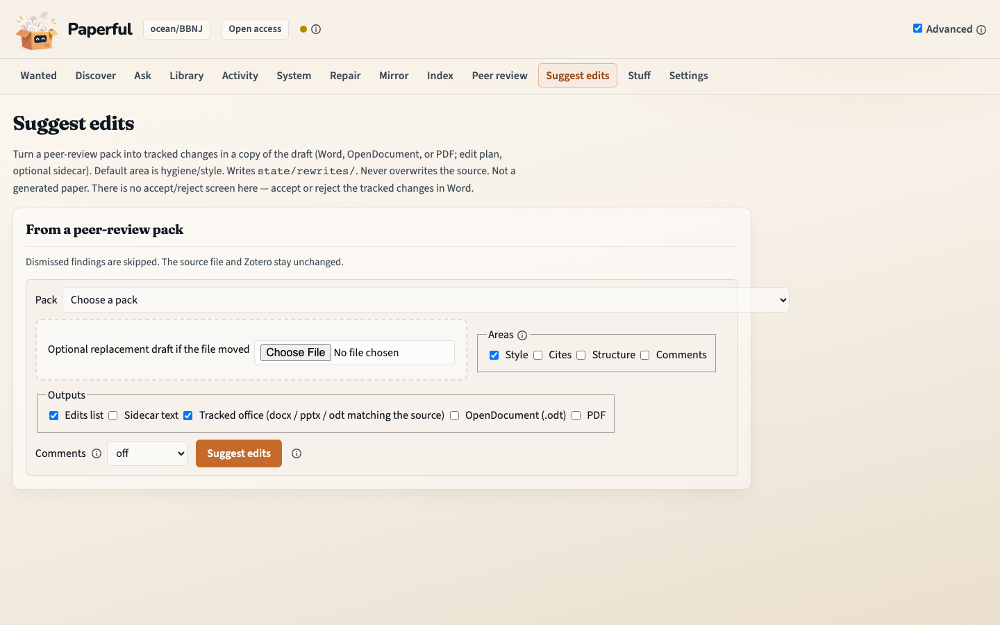

# Rewrite (apply a peer-review pack)

`paperful rewrite` takes an existing [`peer-review`](peer-review.md) pack and
proposes locatable edits. The Advanced workbench labels this **Suggest
edits** so it is not read as “the AI rewrites my paper.” It is
**apply-from-peer-review**. It does not re-run peer-review,
does not overwrite the source file, and does not write to the reference
manager.

Default area is **style** (hygiene: Vale, glossary/acronyms, prose). LLM
rewrites return a **whole paragraph**; Paperful diffs it to a span. Other
areas (`cites`, `structure`, `comments`) are opt-in. Outputs are an edit plan
always, plus optional sidecar text and office files: Word tracked-changes,
OpenDocument (`.odt`), and/or PDF. `--output tracked` follows the source
suffix (Word spine for markdown / PDF / HTML / RTF). `--output odt` and
`--output pdf` can be requested for any source.

Paperful does not vendor [PaperOrchestra](https://github.com/google-research/paper-orchestra),
[ARIES](https://github.com/allenai/aries), or [XtraGPT](https://huggingface.co/collections/Xtra-Computing/xtragpt).
Docs credit the patterns: a worklog, align-then-generate, selected-span prompts.
Product routing vs PaperOrchestra (idea+log → conference LaTeX):
[How Paperful compares](comparison.md) and the
{ref}`comparison reference <paperorchestra>`.

## CLI

`--pack`, `--item`, and `--file` locate the peer-review pack. `--file` with
`--pack` is allowed: the pack supplies findings; `--file` is the manuscript
to edit. There is no accept/reject screen in Paperful; accept or reject
tracked changes in Word (or the office app you use). New peer-review packs
store an input file hash. When `--file` does not match that hash (or the
pack’s original path, for older packs), rewrite warns, records `drift`,
and still re-aligns unique quotes. A run that proposes no edits and only
skips (or drifted with nothing to apply) exits **3** (`partial`); a run
that proposes at least one edit exits **0**.

```bash
uv run paperful rewrite --pack state/peer-reviews/file-draft/20261027T...
uv run paperful rewrite --file ./draft.docx
uv run paperful rewrite --item KEY
uv run paperful rewrite --file ./draft.docx --area cites --area structure --comments substantive
uv run paperful rewrite --pack PATH --output edits --dry-run
```

- Exit 1 if no pack exists. Never calls `build_peer_review`. Exit 3 when the
  run finishes with zero edits and every item was skipped (or the file
  drifted and nothing applied). Envelope `exit` matches.
- `--area` (repeatable): `style`, `cites`, `structure`, `comments`, or `all`.
- `--output` (repeatable): `edits`, `sidecar`, `tracked`, `odt`, `pdf`.
- `--comments`: `off` (default), `substantive`, `all` — reviewer/MARG notes as
  Word comments.
- `--dry-run` prints the plan and writes nothing.
- `--format json` → agent envelope. Phase lines on stderr.
- Not in `paperful all`. `paperful jobs` → completeness.

Packs land in `state/rewrites/<peer-review-id>/<stamp>/` as `plan.json`
(`paperful.rewrite.plan.v1`), `pack.md`, and `pack.json`
(`paperful.rewrite.pack.v1`). `--output tracked` writes `tracked.docx` /
`tracked.pptx` / `tracked.odt` matching the source (markdown and other
text sources get a Word spine). `--output odt` always writes `tracked.odt`
(native copy when the source is ODT; otherwise a paragraph spine).
`--output pdf` writes `tracked.pdf` (Playwright Chromium print of the
applied text). Comments become numbered markers plus a Comments page and
PDF sticky notes. Library PDFs are read-only; output is always new files.

## Areas

| Id | Default | What it does |
| --- | --- | --- |
| `style` | on | Vale, glossary/acronyms, `long_sentence` / `hedge_words` / `passive_voice`, plus academic discourse (`weasel_citation`, `hype_copy`, `chatbot_residue`, `marketing_closer`, `discourse_scaffold`) and unquoted library overlap (`text_overlap`). Glossary `suggested` and obvious Vale swaps are deterministic. Discourse and overlap are comments (chatbot leftovers may drop). Overlap comments name a held item key and pages; they do not insert a cite |
| `cites` | off | Bibliography locators. Cite keys only from the extract/pack. Retracted / withdrawn / EoC cites are comments, never deletes. `text_overlap` comments also run here if style is off |
| `structure` | off | Missing section headings, float caption/mention, missing ethics/data mentions. No invented results |
| `comments` | off | Suggested findings and reviewer notes as comments on a unique span or heading |

Always skip: dismissed rows, direct quotations, AI-tells / Binoculars,
PaperGuard, file-health, metrics summaries, identity lint, non-actionable praise.
AI-tell codes stay skipped so Suggest edits is not a detector scrubber.
Discourse hygiene is a separate checked lane. Unquoted `text_overlap` is a
**comment** on the copy (default style area, or cites if style is off): the
library item key and pages, not an inserted `\cite{}`. That comment is not
gated by `[rewrite].stock_comments`. See [peer-review overlap](peer-review.md).

After edits, Paperful **sanitizes the copy** it writes (sidecar, tracked office,
PDF): invisible Unicode, C2PA provenance parts, and token-tracker channels
(homoglyph fold plus freeze-preserving closed-class swaps). Never the source.
`--no-sanitize` / `[rewrite].sanitize = false` turns the whole pass off.
This is not a Turnitin or GPTZero bypass.

LLM is required only when a selected area still has findings without a
deterministic replacement. Style-only glossary/Vale substitutions run with
`[llm]` off.

## Config

```toml
[rewrite]
areas = ["style"]                 # style | cites | structure | comments | all
outputs = ["edits", "tracked"]    # edits | sidecar | tracked | odt | pdf
comments = "off"                  # off | substantive | all
max_edits = 80
timeout_s = 0                     # per area LLM call; 0 → max([llm].timeout_s, 600)
openxml_audit = false             # optional extra: uv sync --extra openxml (docx/pptx/odt)
openxml_audit_policy = "warn"     # warn | fail
sanitize = true                   # copies only
sanitize_invisible = true
sanitize_c2pa = true
sanitize_trackers = true
tracker_scope = "edited"          # edited | all
tracker_rate = 0.08
tracker_prose = true
facts_worklog = true
tell_regression = true
critic = false
stock_comments = true

[[rewrite.specialists]]
id = "style"
model = ""                        # empty → [llm].model; may be an XtraGPT Ollama tag
prompt = "default"                # or prompts/rewrite-style.md
```

`[[rewrite.specialists]]` is separate from `[rewrite].areas` (enabled ids)
because TOML cannot use the same key for a string list and an array of tables.

Optional area model: an Ollama tag from `Xtra-Computing/XtraGPT-GGUF`. Default
remains `[llm].model`. ICLR/ReviseQA criteria are ML-shaped; ocean/policy
drafts should not assume them. See [llm.md](llm.md).

## Honesty

- No new numbers, experiments, or cite keys unless they already appear in the
  extract, the finding, or the pack.
- Unflagged text is unchanged.
- Body edits must not mention Paperful, the peer-review pack, or “the reviewer”.
- Weak alignment → skip or a Word comment, not a guessed rewrite.
- Tracked-changes v1 uses stdlib OOXML for `.docx`. Unique paragraph match
  only; miss → skip. If a paragraph has run properties, fields, existing
  revisions, or a text box, rewrite leaves the runs and writes a Word
  comment instead of flattening (the comment states why, the finding detail,
  and any suggested replacement). Apply-time misses are recorded on the plan
  (`docx_miss` / `office_miss`). Figure ``wp:inline`` drawing blocks are copied
  verbatim from the source so inline DrawingML namespaces survive (Word otherwise
  refuses to open the file). Complex Word is not round-tripped beyond that.
  `.pptx` / `.odt` get a copy with unique-span
  replacements (not Word revision markup; comments stay in the edit plan).
  `--output odt` on a non-ODT source builds a paragraph OpenDocument spine
  the same way. `--output pdf` prints the applied text with numbered comment
  markers, a Comments page, and PDF sticky notes (not Word tracked-changes).
  Optional `[rewrite].openxml_audit` runs
  [openxml-audit](https://pypi.org/project/openxml-audit/) (Microsoft Open XML
  SDK port plus ODF adapter; `paperful[openxml]`) on office files and
  reports errors **not already on the source**. Word-authored drafts can fail
  the SDK on `stylesWithEffects`; those are ignored. `fail` exits 1 when
  rewrite introduced a new issue. Stdlib structure checks (comment ranges,
  Ignorable prefixes, slide/content XML, PDF header) always run on those
  outputs. Paperful does not write `.xlsx`; forensics only reads tables.

## Workbench



Advanced **Suggest edits** (next to Peer review; CLI is still `paperful rewrite`):
pick a recent peer-review pack, optional replacement draft, area/output/comments
and copy-sanitizer controls, download the result. Default style comments include
unquoted library overlap (`text_overlap`) when the pack has it. With no pack on
disk, the page shows only **Run Peer review first** with an **Open Peer review**
link.

## See also

[peer_review](peer-review.md) · [config](config.md) · [llm](llm.md)
